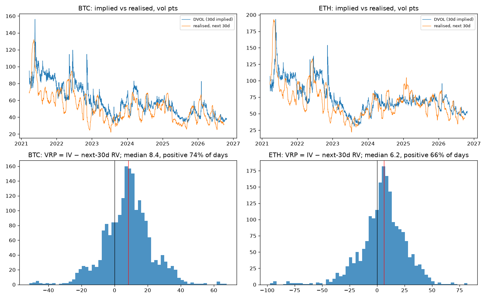
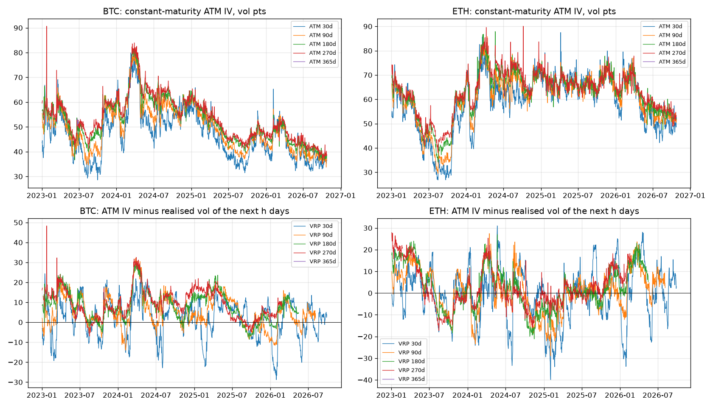

# The 30-day variance risk premium, BTC and ETH, 2021–2026

Deribit's DVOL index (30-day constant-maturity implied vol) against the realised vol of the next 30 days, from Binance hourly closes. Mar 2021 to late Sep 2026; the last 30 days have no "next 30 days" yet.

**Result:** selling 30-day vol has been paid less every year. BTC: 16 vol points in 2021, 1 in 2026. ETH went negative in 2025. The losses sit in a few squeeze months.

## Why it should exist
Option buyers pay for insurance. Sellers are paid implied vol and pay out realised. If buyers overpay on average, implied sits above realised and the seller collects the gap.

## Data
- DVOL hourly, `vr/deribit.py`, from 2021-03-24.
- BTCUSDT and ETHUSDT hourly closes, Binance spot, `vr/spot.py`.
- Realised vol: hourly log returns over the next 30 days, annualised. One observation a day at 00:00 UTC.

## Result

| | Mean VRP | Median | Days implied > realised | Worst 10% of days |
| --- | --- | --- | --- | --- |
| BTC | +7.9 | +8.4 | 74% | −9.3 |
| ETH | +5.3 | +6.2 | 66% | −19.6 |

Vol points: implied minus what the coin then did.

| BTC | 2021 | 2022 | 2023 | 2024 | 2025 | 2026 |
| --- | --- | --- | --- | --- | --- | --- |
| Mean VRP | +16.4 | +13.0 | +7.3 | +6.3 | +3.7 | +1.1 |
| Days positive | 87% | 73% | 76% | 77% | 71% | 59% |

| ETH | 2021 | 2022 | 2023 | 2024 | 2025 | 2026 |
| --- | --- | --- | --- | --- | --- | --- |
| Mean VRP | +10.9 | +10.7 | +6.0 | +2.5 | −1.3 | +3.9 |
| Days positive | 78% | 64% | 75% | 66% | 51% | 66% |

Worst months to have sold, by month of sale: BTC Jan 2026 (−16.1), Feb 2025 (−13.8), Apr 2021 (−13.6), Jul 2024 (−10.7). ETH Apr 2021 (−48.8), Feb 2025 (−24.3), May 2021 (−22.1). A losing stretch lasts 4 days on BTC and 6 on ETH at the median; the longest ran 41 and 59 days.

Nov 2022 was one of the best months to sell: implied jumped on FTX and realised then calmed, +33.7 on BTC.



## By tenor: is vol more expensive further out?
*Added 2026-10-25, from daily option prices.* DVOL covers only 30 days, so the premium at longer tenors is rebuilt from every traded Deribit option, Jan 2023 – Oct 2026 (2,810 per-expiry files from CryptoDataDownload; they match Deribit's own daily candles, 08:00 to 08:00 UTC, exactly). Option price × forward (the matching dated future, else the perpetual times the futures-curve basis) gives a USD price; Black-76 at zero rates gives the implied vol. Kept: options that traded that day, 2+ days to expiry, |delta| 0.2–0.8. ATM vol per expiry by interpolating at the forward; constant-maturity ATM by interpolating total variance between the two bracketing expiries, no extrapolation (`vr/term.py`, `scripts/run_term_vrp.py`). The rebuilt 30-day ATM tracks DVOL with correlation 0.989 (BTC) and 0.986 (ETH); DVOL sits 2.0 and 2.6 points higher, as it includes the wings.

| | Tenor | Mean ATM IV | Mean realised next | Mean VRP | Median | Days positive | Independent windows |
| --- | --- | --- | --- | --- | --- | --- | --- |
| BTC | 30d | 47.2 | 44.7 | +2.5 | +3.9 | 66% | 45.5 |
| BTC | 90d | 50.6 | 45.3 | +5.3 | +4.4 | 75% | 14.6 |
| BTC | 180d | 53.9 | 45.6 | +8.3 | +8.1 | 85% | 6.8 |
| BTC | 270d | 55.7 | 46.2 | +9.5 | +9.0 | 92% | 4.2 |
| ETH | 30d | 58.8 | 59.1 | −0.3 | +0.7 | 53% | 45.5 |
| ETH | 90d | 61.1 | 60.0 | +1.1 | +2.2 | 59% | 14.6 |
| ETH | 180d | 63.4 | 60.8 | +2.6 | +1.7 | 59% | 6.8 |
| ETH | 270d | 64.4 | 62.0 | +2.4 | +0.6 | 54% | 4.0 |

| Mean VRP by year | 30d | 90d | 180d | 270d |
| --- | --- | --- | --- | --- |
| BTC 2023 | +3.4 | +6.5 | +8.5 | +8.5 |
| BTC 2024 | +4.6 | +7.1 | +10.3 | +13.1 |
| BTC 2025 | +2.0 | +4.4 | +6.9 | +7.5 |
| BTC 2026 | −1.0 | +2.0 | +5.7 | +5.8 |
| ETH 2023 | +1.3 | +4.0 | +4.7 | +3.9 |
| ETH 2024 | +0.3 | −0.5 | +0.2 | +0.5 |
| ETH 2025 | −3.7 | −3.2 | −0.4 | +1.7 |
| ETH 2026 | +1.5 | +6.2 | +11.1 | +10.3 |

On BTC the premium rises with tenor in every year. On ETH it does not. 365 days cannot be measured from listed options: the longest traded Deribit expiry is a median 320 days out, and two-year vol is not listed. A 270-day window since 2023 gives about four non-overlapping samples, all in one period of falling BTC vol.



## What it means
[Yashish's sentence.]

## Limits
- DVOL is 30-day only; the tenor section is ATM only (no skew, no wings) and starts in 2023.
- 2,015 daily observations of overlapping 30-day windows are about 67 independent ones.
- DVOL is an index. No fees, no hedging cost, no path: this is the premium, not a strategy's return.
- Realised vol from hourly closes reads slightly differently from daily closes.

## Reproduce
```bash
python -m vr.spot --start 2021-01-01 && python -m vr.deribit dvol && python scripts/run_vrp.py
```
